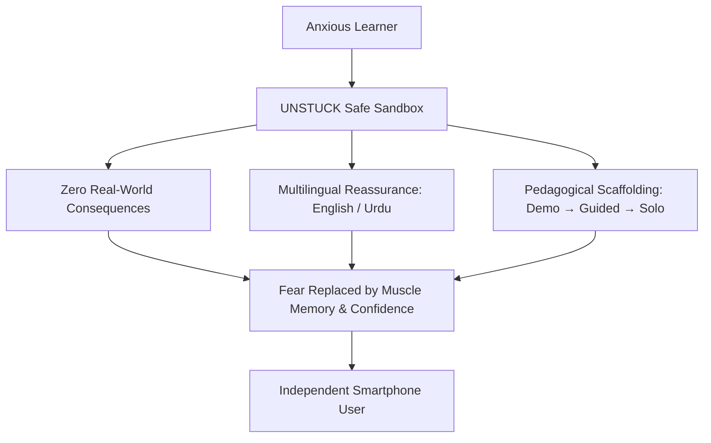
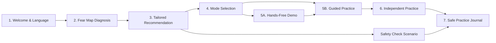
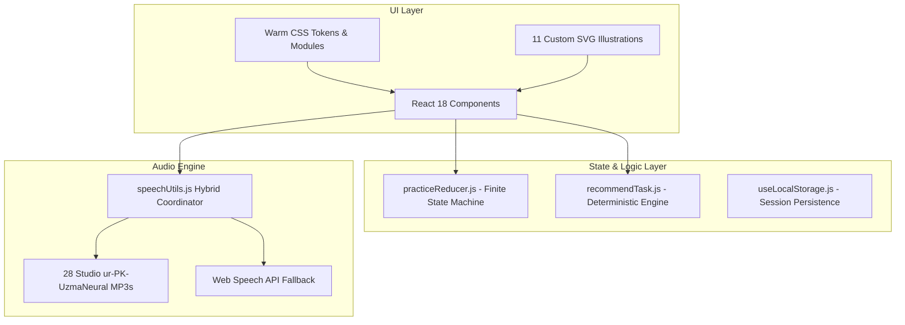

# UNSTUCK — Comprehensive Product, Architecture & Feature Specification

> **A Confidence-First Digital Practice Playground for Late Technology Adopters**  
> *Version: 2.0.0 (Production Hackathon Edition)*  
> *Project Root: `C:\Users\Connect2Aryans\Desktop\UNSTUCK\`*  
> *Target Audience: Older adults, anxious late technology adopters, non-technical learners*  

---

## 1. Executive Overview & Mission

### 1.1 The Core Problem
For millions of older adults and late technology adopters, modern smartphones are not intuitive tools—they are sources of anxiety, dread, and vulnerability. A simple action like tapping an icon brings questions of catastrophic failure:
* *"If I tap this, will I delete all my photos forever?"*
* *"Will I accidentally send something private to everyone in my contacts?"*
* *"Will money be deducted from my bank account?"*
* *"Will a scammer steal my identity if I open this message?"*

Traditional tutorials fail this audience because they are either:
1. **Passive videos or text manuals** where learners watch but forget the moment they try it themselves.
2. **High-stakes live environments** where learners are forced to practice on their actual phones with their real contacts, real photos, and real bank accounts on the line.

### 1.2 What UNSTUCK Is
**UNSTUCK** is a browser-based, zero-risk digital practice environment that acts as a safe, forgiving flight simulator for everyday mobile technology. It allows anxious learners to explore, make mistakes, tap the "wrong" buttons, and learn through direct hands-on trial without touching their real devices, messaging real contacts, or spending real money.



### 1.3 Core Pillars & Psychological Design Principles
* **100% Isolated Sandbox:** No real phone numbers, no real contacts, no real cloud storage, and no backend API. If a user presses "Delete" or "Send", nothing in the real world is altered.
* **Warm, Non-Clinical Human Aesthetic:** Scandinavian warmth meets Apple Human Interface Guidelines. Soft linen/oat paper background (`#FAF8F5`), botanical emerald accents (`#1E5E4F`), warm terracotta touches (`#E07A5F`), and comforting rounded cards.
* **Zero Testing Pressure:** Absolutely no grades, timers, error buzzers, point deductions, or pass/fail scores. Every misstep is met with an immediate, compassionate explanation of what the button actually does.
* **Trilingual Inclusivity:** Native English, Studio-Pronounced Pakistani Urdu (اردو) with authentic Microsoft Neural Voice audio, and Roman Urdu.

---

## 2. End-to-End User Experience & Flow

UNSTUCK guides learners through a cohesive, confidence-building journey:



### Screen 1: Welcome & Language Selector (`WelcomeScreen.jsx`)
* **Purpose:** Sets an immediate tone of warmth, psychological safety, and hospitality.
* **Key Features:**
  * One-tap trilingual switch: **English**, **اردو (Urdu)**, and **Roman Urdu**.
  * Large, friendly hero illustration with high-contrast, welcoming typography.
  * Three foundational reassurances:
    * 🛡️ **100% Safe Sandbox:** Nothing touches your real phone, bank, or apps.
    * 🐢 **Your Own Speed:** No timers, no scoring, no tests. Take as long as you need.
    * 🔓 **Zero Setup:** No passwords, logins, phone numbers, or credit cards required.
  * **Studio Voiceover:** A prominent speaker button that reads the entire welcome message in calm, natural Pakistani Urdu.

---

### Screen 2: The Digital Fear Map (`FearMapScreen.jsx` & `ChoiceCard.jsx`)
* **Purpose:** Diagnoses the learner's specific anxieties before suggesting an activity, honoring their autonomy.
* **7 Illustrative Anxiety Cards:**
  Each card features a custom, colorful vector illustration, an accessible checkbox, a comforting description, and an individual audio voiceover button:
  1. **"I'm afraid I'll press the wrong thing"** (`card_wrong_button.svg`) — Explains what buttons do before tapping.
  2. **"I worry I might delete something"** (`card_deleting.svg`) — Practice selecting items safely without fear of losing files.
  3. **"I find it hard to find things on my phone"** (`card_navigation.svg`) — Navigation, menus, and finding pictures.
  4. **"I want to learn to send pictures or files"** (`card_sending_picture.svg`) — Attaching and sharing media step-by-step.
  5. **"Some messages make me unsure"** (`card_message_safety.svg`) — Spotting OTP scams, urgent threats, and fake bank alerts.
  6. **"I prefer to listen instead of reading"** (`card_prefers_audio.svg`) — Voice-guided practice.
  7. **"The words on my phone are difficult to understand"** (`card_language_difficulty.svg`) — Plain-language, jargon-free explanations.

---

### Screen 3: Personalized Recommendation (`RecommendationScreen.jsx`)
* **Purpose:** Dynamically evaluates the user's selected concerns and recommends the ideal starting module with complete transparency.
* **Key Features:**
  * **Hero Module Banner:** Renders the 320x120px illustrative vector banner corresponding to the selected task.
  * **"Why we suggested this" Card:** Transparent pedagogical justification (e.g., *"Since you mentioned worrying about losing files, let's practice how the Trash Bin keeps deleted items safe for 30 days."*).
  * **Safety Boundary Reassurance:** Explicit guarantee that no real files or messages can be lost.
  * **Autonomous Choice:** The user can accept the suggestion (`Start Practice →`) or freely choose any other module via the Skill Map.

---

### Screen 4: Practice Mode Selector (`PracticeIntroScreen.jsx`)
* **Purpose:** Gives learners control over how they want to learn.
* **Dual Pedagogy:**
  1. **"Show me first (Watch demo)":** A 100% hands-free visual demonstration where the interface auto-navigates and uses an animated pointing hand (`👆`) to demonstrate each step.
  2. **"Try with me (Guided practice)":** Step-by-step interactive practice where the user taps controls on a realistic simulated phone with active hints and guidance.

---

### Screen 5: Dual Practice Engine (`GuidedPracticeScreen.jsx` & `IndependentAttemptScreen.jsx`)
* **Purpose:** Delivers realistic mobile phone simulation with three-tiered cognitive scaffolding.
* **Key Features:**
  * **Realistic Phone Chassis:** Matte dark smartphone frame (`380px x 690px`) featuring a dynamic status bar (`9:41 AM`, WiFi, battery), realistic navigation bars, and responsive tactile taps.
  * **3-Tiered Hint Ladder:**
    * *Tier 1:* Conceptual hint ("Look for a button used to add something to a message").
    * *Tier 2:* Visual cue ("It is near the message box, shown as a paperclip icon").
    * *Tier 3:* Direct spotlight ("Let me show you — tap this highlighted button right here").
  * **"What happens if I tap this?" Panel:** Explains the real-world consequence of a control before touching it.
  * **Independent Practice:** Removes the training wheels and highlights, presenting a fresh scenario (e.g., sending garden flower photos) to solidify muscle memory.

---

### Screen 6: Safety Check Scenario (`SafetyScenarioScreen.jsx`)
* **Purpose:** Teaches cyber defense and scam resilience without fear.
* **Simulated Scenarios:**
  * **Scenario 1 (The Prize / OTP Trap):** A realistic SMS from an unknown number claiming the user won a prize and demanding their 4-digit code.
  * **Scenario 2 (Urgent Bank Account Alert):** A threatening text claiming the user's account is suspended and urging them to click a malicious link.
* **Pedagogical Feedback:** If the user selects the risky option, the app does not say "Wrong!"; it gently explains what the scammer was trying to achieve and how to verify via official channels.

---

### Screen 7: Skill Map & Practice Library (`LibraryScreen.jsx`)
* **Purpose:** A permanent, comprehensive directory of all 4 interactive practice modules.
* **Accessible Anytime:** Users can navigate here directly via the header tab to practice any module at will.
* **Visual Status Pills:**
  * `✓ Practised` — Modules already attempted.
  * `★ Recommended` — Tailored to current fear profile.
  * `● Ready` — Unattempted modules ready for exploration.

---

### Screen 8: Safe Practice Journal (`SummaryScreen.jsx`)
* **Purpose:** Celebrates honest learning progress with zero scores or pressure.
* **Key Features:**
  * **Reassuring Empty State:** When no exercises have been completed yet, it displays a comforting seedling badge (`🌱`) and encouraging copy.
  * **Attempt Records:** Logs completed activities with timestamps and support levels (e.g., *"Completed independently"* vs *"Completed with friendly hints"*).
  * **Continuous Learning Recommendation:** Suggests the logical next skill to try with a single-click action button.

---

## 3. Detailed Specification of the 4 Interactive Modules

| Module ID | Title & Category | Simulated App | Learning Objective | Key Interactions |
|---|---|---|---|---|
| **`send-picture`** | **Send a Picture in a Message**<br>*(Messaging & Media)* | Simulated Messaging Chat (WhatsApp / iMessage style) | Master attaching media without accidental transmission | 1. Tap paperclip icon near chat box.<br>2. Select photo from animated picture tray.<br>3. Review draft photo and tap green send arrow. |
| **`explore-maps`** | **Find Places & Share Live Location**<br>*(Navigation & Maps)* | Simulated Google Maps with vector roads, river & park | Conquer fear of getting lost; share live GPS with family | 1. Tap map search bar for "City Pharmacy".<br>2. Inspect destination pin and tap "Share Location".<br>3. Confirm 15-minute live GPS sharing to family. |
| **`safe-delete`** | **Safely Delete & Restore from Trash**<br>*(Photo Gallery & Storage)* | Simulated Smartphone Photo Gallery & Trash Bin | Eliminate fear of deleting photos permanently | 1. Select blurry test photo & tap Trash Bin.<br>2. Open "Recently Deleted" tab.<br>3. Tap "Restore Photo" to return it safely to gallery. |
| **`check-message`** | **Check Suspicious Messages & Scams**<br>*(Cyber Defense & Safety)* | Simulated SMS Lockscreen Notifications | Recognize phishing warning signs and OTP protection | 1. Read simulated OTP / Bank alert message.<br>2. Select safe response ("Ignore & Call Bank").<br>3. Review safety explanation and official guidance. |

---

## 4. Technical Architecture & Engineering Standards



### 4.1 Technology Stack
* **Framework:** React 18.3.1 (Modern functional components, Hooks, Error Boundaries).
* **Build System:** Vite 5.4.21 (ESM modules, instant HMR, optimized production tree-shaking).
* **Styling:** Modular CSS (`*.module.css`) + Centralized CSS Custom Properties ([`tokens.css`](file:///c:/Users/Connect2Aryans/Desktop/UNSTUCK/src/styles/tokens.css)).
* **Audio Synthesis:** `edge-tts` (Microsoft Neural Engine `ur-PK-UzmaNeural` BCP-47 `ur-PK`) + HTML5 Audio + Web Speech API fallback.
* **Testing:** Headless Google Chrome (`puppeteer-core`) end-to-end automation.

### 4.2 Deterministic Audio Architecture
To eliminate unpredictable voice synthesis on host operating systems (e.g. Windows machines lacking Urdu voice packs), UNSTUCK employs a **Studio-Native Audio Pipeline**:
1. All 28 Urdu voiceover assets are pre-rendered into standard `.mp3` files located in [`public/audio/ur/`](file:///c:/Users/Connect2Aryans/Desktop/UNSTUCK/public/audio/ur/).
2. Every interactive screen passes a rigid, deterministic `audioKey` (e.g., `welcome`, `concern_wrong_button`, `task_send-picture_0`, `rec_maps`).
3. Audio plays instantly with zero network latency, zero CORS blocking, and 100% natural Pakistani Urdu pronunciation.
4. When **Roman Urdu** is active, all audio buttons are completely suppressed to honor user preferences.

### 4.3 Finite State Machine (`practiceReducer.js`)
The interactive practice runs on a deterministic state machine:
* **States:** `IDLE` → `STEP_IN_PROGRESS` → `HINT_ACTIVE` → `CONSEQUENCE_VIEW` → `STEP_SUCCESS` → `TASK_COMPLETE`.
* **Guards:** Prevents accidental double-taps during automated demonstration mode.
* **Resilience:** Escape key handling closes overlays instantly, and local storage state corruption is caught by a root `ErrorBoundary`.

---

## 5. Verification & Test Evidence

UNSTUCK has undergone rigorous senior-level QA automation:

| Verification Suite | Target | Result | Evidence File |
|---|---|---|---|
| **E2E Browser Journey** | Welcome → Fear Map → Recommendation → Guided Practice → Independent Practice → Summary | **100% PASSED** (0 Errors) | [`scripts/test-e2e-browser.mjs`](file:///c:/Users/Connect2Aryans/Desktop/UNSTUCK/scripts/test-e2e-browser.mjs) |
| **Hands-Free Demo Suite** | Animated pointer badge navigation across steps 1–3 | **100% PASSED** (0 Errors) | [`scripts/test-demo-handsfree.mjs`](file:///c:/Users/Connect2Aryans/Desktop/UNSTUCK/scripts/test-demo-handsfree.mjs) |
| **All-Features Suite** | 4 Modules: Messaging, Maps, Safe Delete, Scam Defense | **100% PASSED** (0 Errors) | [`scripts/test-all-features.mjs`](file:///c:/Users/Connect2Aryans/Desktop/UNSTUCK/scripts/test-all-features.mjs) |
| **Warm UI & Aligned Audio** | 7 SVG card badges, 4 module banners, Urdu audio alignment | **100% PASSED** (0 Errors) | [`scripts/test-warm-ui-urdu-alignment.mjs`](file:///c:/Users/Connect2Aryans/Desktop/UNSTUCK/scripts/test-warm-ui-urdu-alignment.mjs) |
| **Vite Production Build** | Zero syntax errors, CSS bundle optimization | **100% PASSED** (82 modules in 871ms) | `npm run build` |

---

## 6. Project Directory Map

```text
C:\Users\Connect2Aryans\Desktop\UNSTUCK\
├── public/
│   ├── audio/ur/                     # 28 Studio-quality Pakistani Urdu MP3 files
│   ├── images/cards/                 # 11 Custom SVG card illustrations & module banners
│   └── favicon.svg                   # Safe shield emblem favicon
├── src/
│   ├── components/                   # 11 Accessible UI components
│   │   ├── AppHeader.jsx             # Top bar with Language Switcher & Universal Back navigation
│   │   ├── ChoiceCard.jsx            # Fear Map card with SVG illustrations & speaker
│   │   ├── SimulatedPhone.jsx        # Multi-task simulated smartphone chassis
│   │   ├── StepIndicator.jsx         # Accessible step counter
│   │   ├── HintPanel.jsx             # 3-tiered hint ladder
│   │   └── PrimaryButton.jsx         # Large, tactile senior-friendly action button
│   ├── screens/                      # 8 App screens
│   │   ├── WelcomeScreen.jsx         # Welcome & foundational reassurance
│   │   ├── FearMapScreen.jsx         # Digital Fear Map diagnostic grid
│   │   ├── RecommendationScreen.jsx  # Pedagogical recommendation card
│   │   ├── PracticeIntroScreen.jsx   # Demo vs. Guided mode selection
│   │   ├── GuidedPracticeScreen.jsx  # Step-by-step interactive practice
│   │   ├── IndependentAttemptScreen.jsx # Practice without training wheels
│   │   ├── SafetyScenarioScreen.jsx  # OTP & Phishing defense scenarios
│   │   ├── LibraryScreen.jsx         # Skill Map & All Features catalog
│   │   └── SummaryScreen.jsx         # Safe Practice Journal & attempt history
│   ├── logic/                        # Core algorithms
│   │   ├── practiceReducer.js        # Practice finite state machine
│   │   ├── recommendTask.js          # Deterministic recommendation heuristics
│   │   └── speechUtils.js            # Studio MP3 audio coordinator
│   ├── styles/                       # CSS architecture
│   │   ├── tokens.css                # Warm linen palette, typography, shadows
│   │   ├── global.css                # Global resets & animations
│   │   └── phone.css                 # Simulated phone, Google Maps & Gallery CSS
│   ├── App.jsx                       # Master state router & audio coordinator
│   └── main.jsx                      # React 18 root with Error Boundary Armor
├── Tasks/                            # Master Vault task documentation & evidence
├── Master_Development_Log.md         # Running governance log of all 9 development entries
└── UNSTUCK_Comprehensive_App_Summary.md # This master document
```

---

## 7. Summary Statement

**UNSTUCK** demonstrates that technology anxiety in older adults is not an inevitable consequence of aging—it is a design failure of existing software. By replacing high-stakes live environments with an **empathic, trilingual, zero-risk flight simulator**, UNSTUCK restores digital dignity, builds durable muscle memory, and empowers learners to explore the modern world with confidence.
